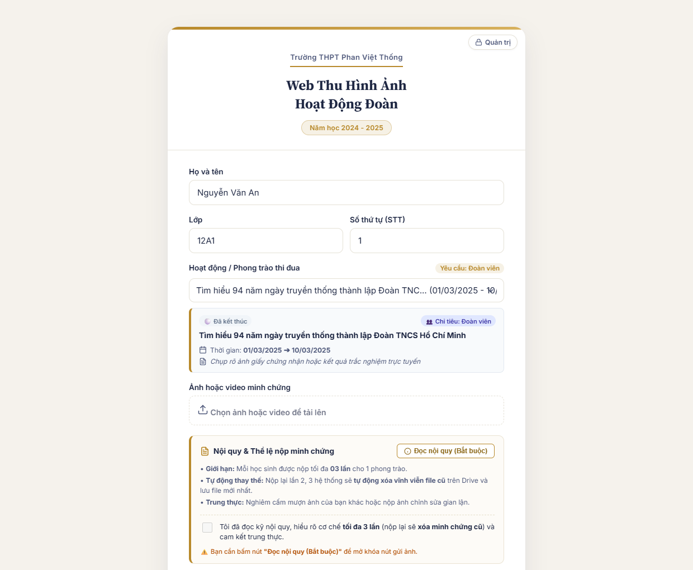
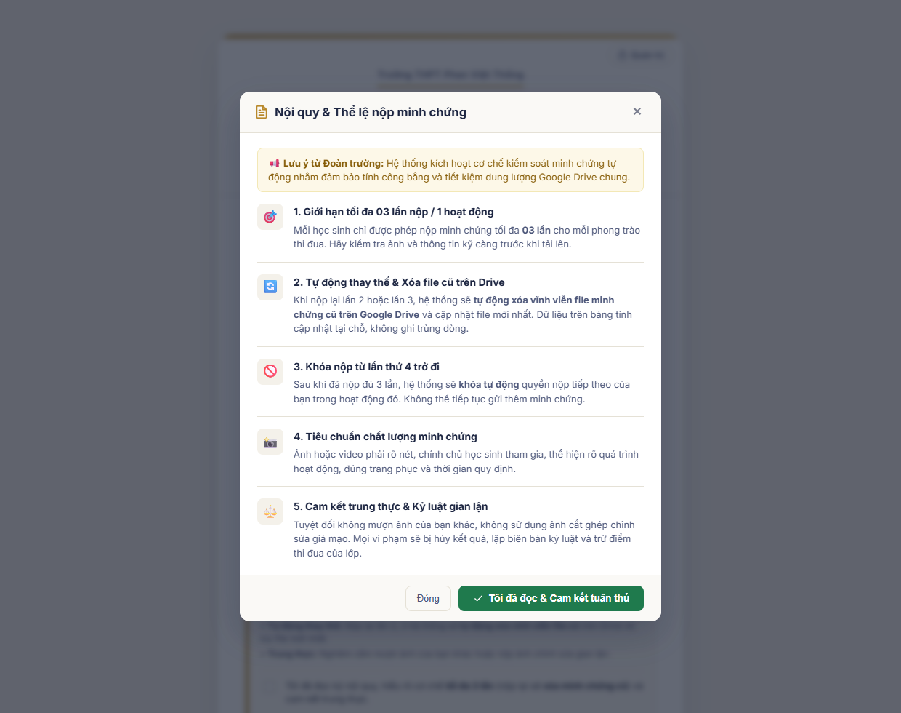
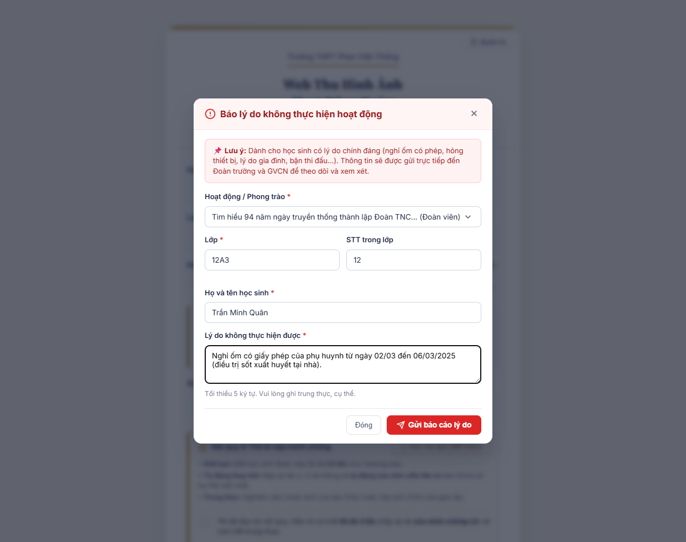
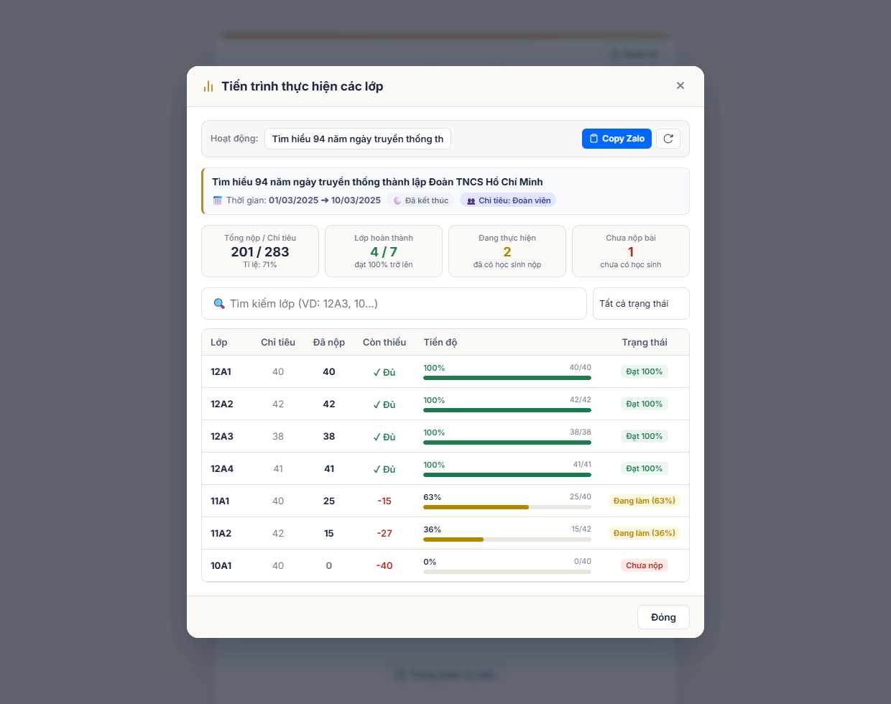
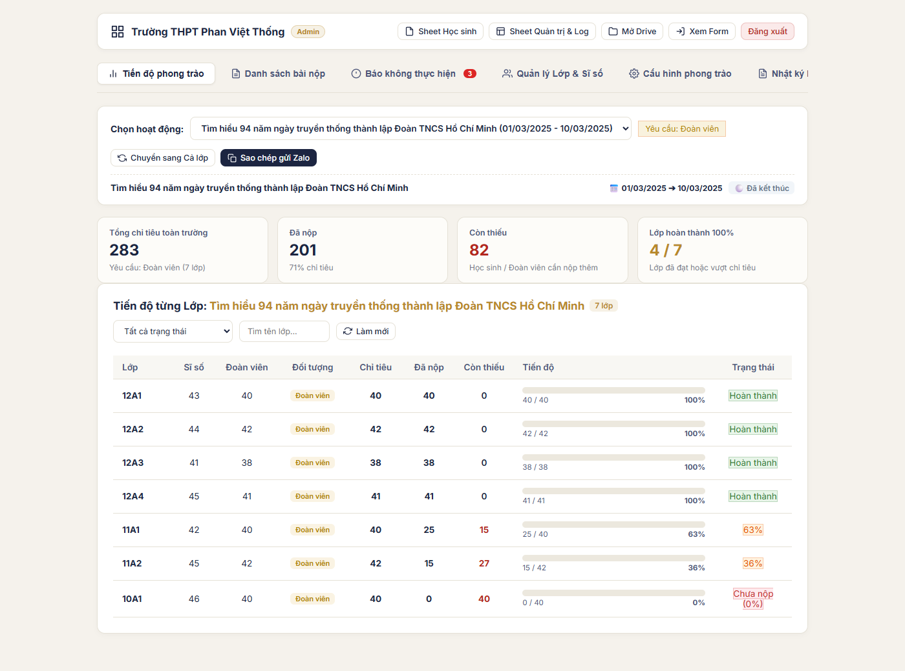
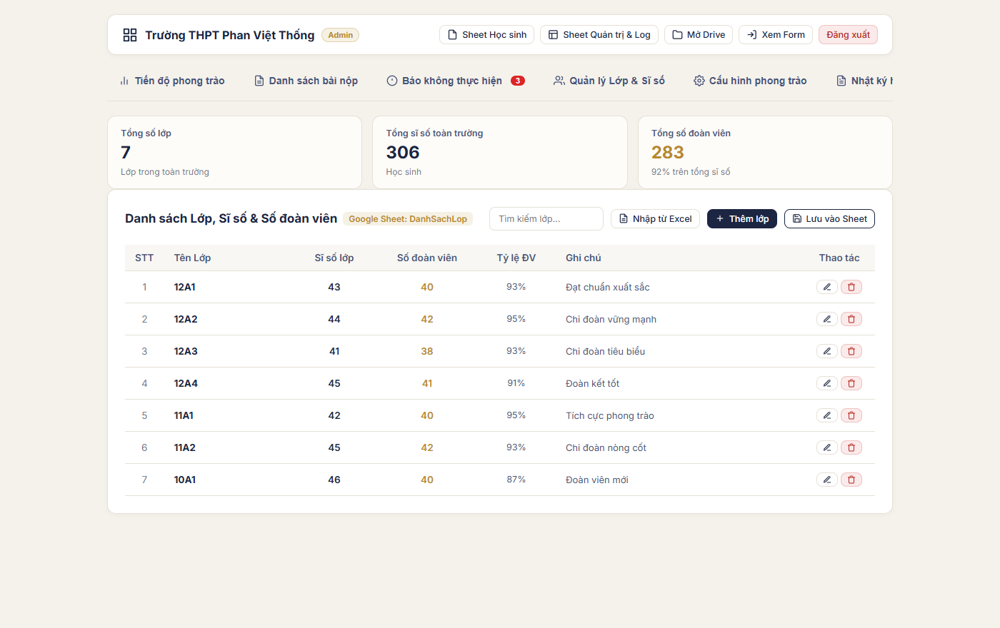
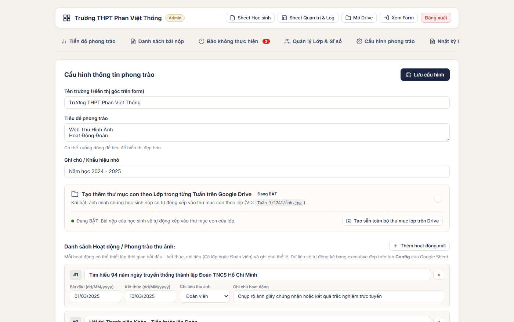
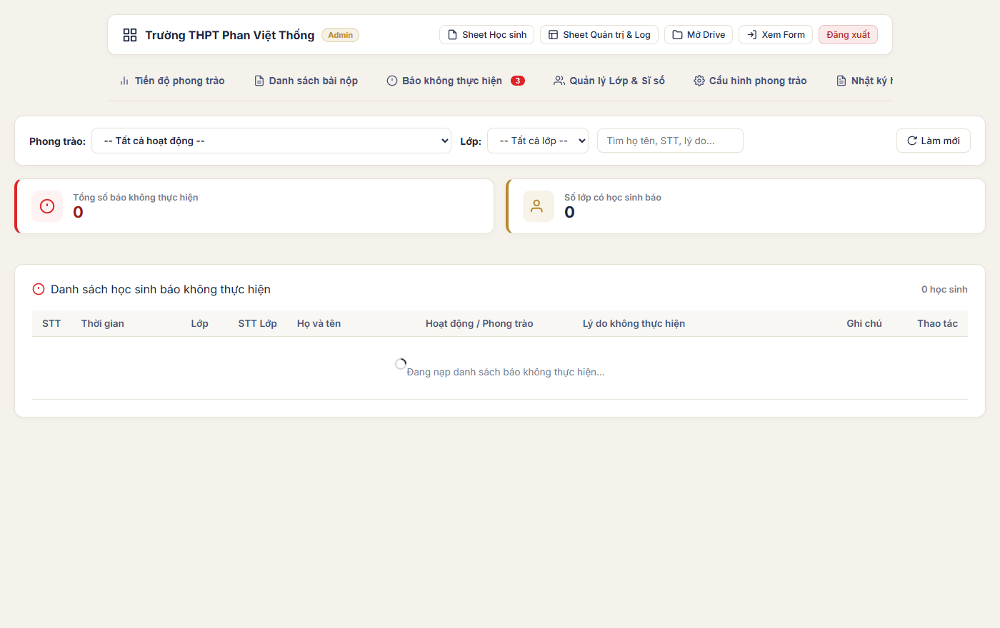

# Web Thu Hình Ảnh Hoạt Động Đoàn

Ứng dụng web chạy trên **Google Apps Script** giúp học sinh nộp ảnh/video minh chứng hoạt động Đoàn theo từng tuần. File được lưu tự động vào **Google Drive**, dữ liệu (họ tên, lớp, thời gian, link ảnh) được ghi vào **Google Sheet** — không cần server riêng, không tốn phí hosting.

> 📁 **Drive Demo thực tế**: [Xem thư mục Google Drive mẫu](https://drive.google.com/drive/folders/1EW39H6RnS33-lJf6CG3D0o08EWxAlME1?usp=sharing) (Minh họa cấu trúc thư mục theo Hoạt động, Lớp và quy tắc đặt tên file tự động).

## 📸 Hình ảnh giao diện (Demo Screenshots)

### 1. Phía Học sinh & Công khai
| Form nộp bài & Bắt buộc đọc nội quy | Modal Nội quy & Cam kết tuân thủ | Báo không thực hiện được (Lý do nghỉ) | Tiến độ các lớp & Copy Zalo |
| :---: | :---: | :---: | :---: |
|  |  |  |  |

### 2. Phía Quản trị viên (Admin Portal)
| Dashboard tiến độ phong trào & Chỉ tiêu | Quản lý Sĩ số & Số đoàn viên từng lớp |
| :---: | :---: |
|  |  |

| Cấu hình phong trào, thời gian & chỉ tiêu | Quản lý Báo cáo không thực hiện được |
| :---: | :---: |
|  |  |

## Tính năng

- **Cơ chế Chống gửi trùng & Giới hạn tối đa 3 lần nộp bài**:
  - Mỗi học sinh (nhận diện chính xác theo **Lớp + Số thứ tự (STT)** hoặc **Họ và tên**) chỉ được phép nộp ảnh minh chứng tối đa **3 lần** cho mỗi hoạt động/phong trào.
  - Khi học sinh cố gắng gửi bài lần thứ 4, hệ thống sẽ tự động chặn và từ chối xử lý, kèm thông báo giải thích rõ ràng.
  - **Kiểm tra trạng thái tự động thời gian thực (Real-time Async Check)**: Ngay khi học sinh nhập xong STT, Họ tên, chọn Lớp và Hoạt động, hệ thống lập tức kiểm tra và hiển thị thẻ thông báo học sinh đã nộp mấy lần (1/3, 2/3, 3/3), kèm hướng dẫn cụ thể.
- **Tự động Dọn dẹp & Xóa file cũ trên Google Drive**:
  - Khi học sinh nộp lại minh chứng (lần 2 hoặc lần 3), hệ thống sẽ **tự động tìm và chuyển file ảnh cũ trước đó vào thùng rác (`setTrashed(true)`)**, chỉ giữ lại duy nhất 1 file nộp mới nhất trên Google Drive.
  - Ngăn ngừa hoàn toàn nguy cơ đầy dung lượng bộ nhớ Google Drive của trường do học sinh nộp đi nộp lại nhiều lần.
  - Ghi nhận và cập nhật trực tiếp tại chỗ (in-place row update) trên cả sheet phong trào và sheet tổng hợp `DanhSachHocSinh`, tăng bộ đếm **Lần nộp**, không sinh dòng rác và bảo toàn thứ tự sắp xếp STT.
- **Quy trình Bắt buộc Đọc & Cam kết Nội quy (Consent-gated UI)**:
  - Tích hợp khối **Nội quy nộp ảnh minh chứng** ngay phía trên nút gửi.
  - Hộp kiểm (checkbox) cam kết bị khóa (disabled) mặc định nhằm ngăn chặn việc học sinh bấm bừa mà không đọc.
  - Học sinh bấm **"Đọc nội quy (Bắt buộc)"** để mở modal chi tiết 5 quy định trọng yếu (độ rõ nét của ảnh, minh chứng chính chủ, giới hạn 3 lần nộp & tự động xóa file cũ, hình thức xử lý vi phạm).
  - Chỉ sau khi bấm nút **"Tôi đã đọc & Cam kết tuân thủ"**, checkbox mới tự động đánh dấu và mở khóa nút **"Gửi ảnh ngay"**.
- **Báo không thực hiện được (Dành cho học sinh nghỉ ốm / hỏng thiết bị / lý do chính đáng)**:
  - Cung cấp kênh báo cáo chính thức và minh bạch cho học sinh có trở ngại khách quan không thể tham gia phong trào (nghỉ ốm có phép, hỏng điện thoại/máy tính, bận lịch thi học sinh giỏi, việc gia đình đột xuất...).
  - Nút **"Báo không thực hiện được (Lý do nghỉ / Không thể tham gia)"** với icon cảnh báo màu cam nổi bật đặt ngay dưới các nút tác vụ trên form nộp bài.
  - **Tự động điền trước (pre-fill)**: Nếu học sinh đã nhập Họ tên, Lớp hoặc STT ở form chính, modal sẽ tự động lấy sang giúp tiết kiệm tối đa thời gian.
  - **Chống trùng lặp & cập nhật tại chỗ**: Nếu học sinh gửi lại lý do mới cho cùng một hoạt động, hệ thống sử dụng thuật toán nhận diện học sinh `isSameStudent_` kết hợp `LockService` (khóa 30 giây) để cập nhật nội dung lý do mới ngay tại dòng cũ, tránh sinh dòng rác.
  - **Lưu trữ chuyên biệt trong Google Sheet**: Dữ liệu tự động ghi vào sheet tab `BaoKhongThucHien` (trên file Google Sheet Học sinh) với định dạng header đỏ rượu vang (`#991B1B`), tự động đánh số STT liên tục và sắp xếp theo Lớp và STT.
  - **Ghi nhận lịch sử kiểm toán (Audit Trail)**: Mọi lượt báo cáo hoặc cập nhật lý do đều được tự động ghi vào tab `Log` trên Sheet Quản trị.
  - **Tab Quản lý riêng trên Admin Portal**:
    - Tab **"Báo không thực hiện"** trên thanh điều hướng kèm huy hiệu (badge đỏ) hiển thị số lượng trường hợp cần xử lý.
    - Bộ lọc đa năng theo Hoạt động/Phong trào, theo từng Lớp và ô tìm kiếm tức thì theo từ khóa, họ tên, lý do.
    - Thẻ thống kê KPI tổng quan: Tổng số học sinh báo không tham gia, Số lớp có học sinh báo cáo.
    - Bảng danh sách trực quan hiển thị đầy đủ thời gian, lớp, STT, họ tên, lý do cụ thể, ghi chú trạng thái và nút xóa dành cho quản trị viên.

- **Kiến trúc Tách biệt 2 Google Spreadsheet Độc Lập (`STUDENT_SPREADSHEET_ID` & `ADMIN_SPREADSHEET_ID`)**:
  - **1. File Google Sheet Học sinh (`STUDENT_SPREADSHEET_ID`)**:
    - **Sheet chính `DanhSachHocSinh`**: Nằm ở tab đầu tiên (vị trí số 1), là bảng tổng hợp bài nộp của học sinh toàn trường. Tự động đồng bộ từ mọi phong trào, sắp xếp tuần tự theo Lớp và theo STT (1, 2, 3...) từ trên xuống dưới. Dễ dàng chia sẻ quyền Xem cho GVCN hoặc in ấn danh sách nộp mà không để lộ dữ liệu quản trị.
    - **Các tab Hoạt động**: Mỗi hoạt động có 1 sheet riêng biệt (Tuần 1, Tuần 2...) lưu trữ minh chứng nộp bài của phong trào đó.
  - **2. File Google Sheet Quản trị & Nhật ký (`ADMIN_SPREADSHEET_ID`)**:
    - **Sheet cấu hình `Config`**: Bảng điều hành chuyên biệt lưu trữ cấu hình hệ thống (Tên trường, Tiêu đề, Mật khẩu Admin, Tuỳ chọn Drive) và bảng 6 cột chi tiết về các Hoạt động/Phong trào (Thời gian bắt đầu, Thời gian kết thúc, Chỉ tiêu Cả lớp/Đoàn viên, Thể lệ).
    - **Sheet nhật ký `Log`**: Ghi nhận lịch sử kiểm toán (audit trail) theo thời gian thực mọi hoạt động: học sinh nộp bài, admin xóa bài nộp, sửa cấu hình phong trào, cập nhật sĩ số lớp, đổi mật khẩu và định dạng bảo trì bảng tính.
    - **Tab `DanhSachLop`**: Quản lý nhân khẩu toàn trường (Sĩ số & Số đoàn viên từng lớp) phục vụ tính toán chỉ tiêu.
  - *Lưu ý*: Hệ thống hỗ trợ tương thích ngược — nếu chỉ cấu hình 1 file duy nhất (`SPREADSHEET_ID`), toàn bộ các sheet trên sẽ tự động nằm chung trên 1 file mà không gây lỗi.
- Form nộp ảnh/video đơn giản, tối ưu cho điện thoại: nhập Họ tên, Lớp, **Số thứ tự (STT)** và chọn Tuần.
- **Xem tiến trình thực hiện của các lớp trực tiếp tại trang chủ (Index)**:
  - Nút **"Xem tiến trình thực hiện của các lớp"** đặt ngay dưới nút gửi ảnh giúp học sinh, ban cán sự, GVCN bấm mở modal xem ngay.
  - Xem nhanh tổng số bài đã nộp, chỉ tiêu, số lượng còn thiếu và tỷ lệ % hoàn thành của từng lớp.
  - Hỗ trợ thanh tìm kiếm lớp và bộ lọc theo trạng thái: Đạt chỉ tiêu (≥100%), Đang làm, Chưa nộp bài.
  - Nút **"Copy Zalo"** sao chép tức thì báo cáo tổng kết đẹp mắt để gửi vào nhóm Zalo lớp/trường.
  - Hoàn toàn công khai, an toàn và không yêu cầu mật khẩu quản trị.
- **Tự động sắp xếp (sort) theo thứ tự từ trên xuống dưới**: Dữ liệu ghi vào Google Sheet và hiển thị trên trang Admin luôn tự động sort theo STT tăng dần (1, 2, 3, 4...) và theo Lớp.
- **Trang Quản trị (Admin Portal) nâng cao**:
  - Quản lý chỉ tiêu theo **Sĩ số lớp** hoặc **Số đoàn viên** (linh hoạt theo từng hoạt động/tuần).
  - Quản lý danh sách lớp (Sĩ số & Số đoàn viên) ngay trên giao diện web hoặc tab `DanhSachLop` trong Google Sheet.
  - Xem thống kê tổng số bài nộp, biểu đồ tiến độ và phân loại chi tiết theo từng Lớp/Tuần.
  - Xem danh sách bài nộp sắp xếp chuẩn theo STT, mở ảnh trực tiếp ngay trên web hoặc trên Drive.
  - Tìm kiếm bài nộp nhanh theo họ tên, lớp, STT, thời gian.
  - Xóa bài nộp nộp nhầm hoặc không hợp lệ trực tiếp khỏi Google Sheet.
  - Cập nhật thông tin phong trào, tên trường, danh sách tuần và loại chỉ tiêu trực tiếp trên web mà không cần mở Sheet.
  - Nút định dạng và trang trí lại các tab trong Google Sheet 1-click.
  - Bảo mật bằng mật khẩu quản trị (có thể đổi mật khẩu bất kỳ lúc nào).
- **Nén ảnh ngay trên trình duyệt** trước khi gửi (giảm dung lượng, gửi nhanh hơn) — video gửi nguyên bản.
- Tự động đặt tên file theo dạng `Lớp_STTxx_HọTên_Tuần_ThờiGian.đuôifile`, file trên Drive tự động xếp thứ tự ngăn nắp.
- Tự động tạo thư mục trên Drive theo từng **Tuần hoạt động**, có thể bật thêm thư mục con theo **Lớp**.
- Mỗi tuần tự động có 1 tab riêng trong Google Sheet, định dạng sẵn: header màu, cố định dòng tiêu đề, kẻ sọc xen kẽ, cột **Link ảnh** bấm mở trực tiếp.
- Toàn bộ nội dung hiển thị (tên trường, tên phong trào, ghi chú, danh sách Tuần) **lấy động từ 1 tab "Config"** trong Sheet — sửa nội dung ngay trong Sheet hoặc qua trang Admin, không cần sửa code hay deploy lại.
- Chống ghi đè khi nhiều người gửi cùng lúc (`LockService`).
- Báo lỗi chi tiết theo từng bước (mở Drive / tạo thư mục / tạo file / ghi Sheet) để dễ debug.

## Cấu trúc project

```
.
├── Code.gs      # Toàn bộ logic phía server (Apps Script)
├── Index.html   # Giao diện form nộp bài phía học sinh
├── Admin.html   # Giao diện trang quản trị dành cho giáo viên / phụ trách Đoàn
└── docs/        # Ảnh chụp màn hình demo và tài liệu minh họa
```

## Cài đặt

### 1. Chuẩn bị Google Drive & 2 Google Sheet
- Tạo (hoặc dùng sẵn) **1 thư mục Drive** để chứa ảnh/video nộp lên → lấy **ID thư mục** (đoạn ký tự trong URL sau `/folders/`).
- Tạo **2 file Google Sheet riêng biệt**:
  1. **Sheet Học sinh**: Đặt tên ví dụ `Thu_Hinh_Anh_Hoc_Sinh` → lấy ID làm `STUDENT_SPREADSHEET_ID`. (Chứa tab tổng hợp `DanhSachHocSinh` và các tab nộp bài theo phong trào).
  2. **Sheet Quản trị & Log**: Đặt tên ví dụ `Thu_Hinh_Anh_Quan_Tri_Log` → lấy ID làm `ADMIN_SPREADSHEET_ID`. (Chứa cấu hình `Config`, nhật ký kiểm toán `Log`, và danh sách nhân khẩu lớp `DanhSachLop`).

*(ID Sheet là chuỗi ký tự nằm trong URL giữa `/d/` và `/edit`, ví dụ: `https://docs.google.com/spreadsheets/d/`**`1a2B3c4D...`**`/edit`)*

### 2. Tạo Apps Script project

1. Vào [script.google.com](https://script.google.com) → **New project**.
2. Xoá nội dung mặc định của file `Code.gs`, dán toàn bộ nội dung file `Code.gs` trong repo này vào.
3. Tạo thêm 2 file HTML: **File → New → HTML**:
   - File thứ nhất đặt tên là `Index` → dán nội dung file `Index.html` vào.
   - File thứ hai đặt tên là `Admin` → dán nội dung file `Admin.html` vào.
4. Ở đầu file `Code.gs`, dán các ID bạn đã chuẩn bị:
   ```js
   var STUDENT_SPREADSHEET_ID = 'DÁN_ID_SHEET_HOC_SINH_CỦA_BẠN';
   var ADMIN_SPREADSHEET_ID   = 'DÁN_ID_SHEET_QUAN_TRI_LOG_CỦA_BẠN';
   var MAIN_FOLDER_ID         = 'DÁN_ID_THƯ_MỤC_DRIVE_CỦA_BẠN';
   ```
   *(Nếu bạn chỉ muốn dùng 1 file Google Sheet duy nhất, chỉ cần dán cùng 1 ID vào cả 2 biến hoặc dùng `SPREADSHEET_ID`).*

### 3. Deploy thành Web App

1. **Deploy → New deployment → chọn loại "Web app"**.
2. Cấu hình **bắt buộc đúng** như sau (sai 2 mục này là nguyên nhân phổ biến nhất gây lỗi khi người khác dùng):
   | Mục | Giá trị |
   |---|---|
   | Execute as | **Me** (chủ sở hữu script) |
   | Who has access | **Anyone** *(không chọn "Anyone within [tổ chức]")* |
3. Bấm **Deploy**, copy link `.../exec`:
   - **Link cho học sinh**: `https://script.google.com/.../exec` (hoặc bấm biểu tượng Quản trị viên ở chân trang để vào trang quản trị).
   - **Link vào thẳng trang Admin**: `https://script.google.com/.../exec?page=admin` (Mật khẩu mặc định: `admin123`).

> Nếu dùng tài khoản Google Workspace (email trường/tổ chức), Apps Script hay tự gợi ý "Anyone within [tổ chức]" trông rất giống "Anyone" — để ý kỹ, chọn nhầm sẽ khiến tài khoản Gmail cá nhân không mở được form.

### 4. Khởi tạo tab Config (tuỳ chọn)

Tab `Config` sẽ tự được tạo với giá trị mặc định ngay lần đầu có người mở form hoặc trang admin. Muốn tạo sẵn ngay (không cần đợi ai mở form):

- Mở Apps Script editor → chọn hàm `taoConfigMacDinh` ở thanh **Run** → bấm **Run**.

## Sử dụng Trang Quản Trị (Admin)

Truy cập đường dẫn: `.../exec?page=admin` (hoặc nhấn link **Quản trị viên** ở cuối form học sinh).

- **Mật khẩu mặc định:** `admin123`.
- **Thống kê & Danh sách bài nộp:** Bấm vào từng Tuần để xem số lượng bài nộp, biểu đồ số bài từng lớp, danh sách chi tiết (xem ảnh ngay trên trang, xem trên Drive, tìm kiếm học sinh/lớp, xóa bài nộp).
- **Tiến độ phong trào & Chỉ tiêu:** Theo dõi tiến độ nộp bài của từng lớp và toàn trường; xem chỉ tiêu (dựa theo Đoàn viên hoặc Cả lớp), số lượng đã nộp, số lượng còn thiếu, tỷ lệ % và trạng thái hoàn thành.
- **Quản lý Lớp & Sĩ số:** Nhập và quản lý sĩ số học sinh, số lượng đoàn viên cho từng lớp; hỗ trợ thêm từng lớp hoặc dán sao chép hàng loạt trực tiếp từ bảng tính Excel.
- **Tùy biến chỉ tiêu linh hoạt:** Thiết lập từng tuần/phong trào yêu cầu đối tượng nộp là "Đoàn viên" hay "Cả lớp" với nút chuyển đổi nhanh 1-click.
- **Xuất báo cáo Zalo:** Nút sao chép nội dung báo cáo tiến độ chi tiết, định dạng sẵn icon đẹp mắt để gửi ngay vào nhóm Zalo GVCN/Bí thư chi đoàn.
- **Cấu hình phong trào:** Thay đổi Tên trường, Tên phong trào, Ghi chú, Bật/tắt thư mục con theo Lớp, Thêm/Xóa/Sửa danh sách các Tuần hoạt động kèm yêu cầu đối tượng.
- **Mật khẩu & Công cụ:** Đổi mật khẩu đăng nhập trang Quản trị, định dạng lại bảng tính Sheet 1-click.

## Tuỳ chỉnh qua Google Sheet

Bạn có thể chỉnh sửa qua trang Admin hoặc sửa trực tiếp trong 2 file Google Sheet:

### A. FILE GOOGLE SHEET 1: HỌC SINH (`STUDENT_SPREADSHEET_ID`)

**1. Sheet chính `DanhSachHocSinh` (Đặt ở vị trí tab đầu tiên):**
Bảng tổng hợp toàn bộ bài nộp học sinh của trường qua tất cả các phong trào:
- Cột A: `STT` (Được đánh số tăng dần liên tục 1, 2, 3...)
- Cột B: `Lớp`
- Cột C: `STT Lớp` (Số thứ tự của học sinh trong lớp)
- Cột D: `Họ và tên`
- Cột E: `Hoạt động / Phong trào` (Tên phong trào tham gia)
- Cột F: `Thời gian nộp` (Thời điểm học sinh nộp bài)
- Cột G: `Link ảnh minh chứng` (Link Google Drive mở trực tiếp)
- Cột H: `Lần nộp` (Bộ đếm số lần nộp bài: Lần 1/3, Lần 2/3, Lần 3/3)
*(Dữ liệu luôn được tự động sắp xếp theo Lớp rồi theo STT Lớp tăng dần để phục vụ tra cứu, in ấn).*

**2. Các tab Hoạt động theo phong trào:**
Mỗi phong trào có 1 tab riêng biệt (VD: `Tuan 1`, `Nu cuoi Viet Nam`...) gồm 6 cột: `STT | Họ và tên | Lớp | Thời gian | Link ảnh | Lần nộp`. Tự động kẻ bảng, hiển thị số lần nộp của học sinh và sắp xếp từ trên xuống dưới theo STT và Lớp.

**3. Sheet `BaoKhongThucHien` (Danh sách học sinh báo không thực hiện được):**
Bảng quản lý học sinh có lý do chính đáng không tham gia hoạt động, định dạng header đỏ rượu vang (`#991B1B`):
- Cột A: `STT` (Được đánh số tăng dần liên tục 1, 2, 3...)
- Cột B: `Thời gian báo`
- Cột C: `Lớp`
- Cột D: `STT Lớp`
- Cột E: `Họ và tên`
- Cột F: `Hoạt động / Phong trào`
- Cột G: `Lý do không thực hiện`
- Cột H: `Ghi chú` (Chờ xác nhận / Đã cập nhật lý do)

---

### B. FILE GOOGLE SHEET 2: QUẢN TRỊ & LOG (`ADMIN_SPREADSHEET_ID`)

**1. Sheet chuyên biệt cấu hình `Config`:**
| Ô / Vùng | Ý nghĩa |
|---|---|
| `B2` | Tên trường |
| `B3` | Tên phong trào / tiêu đề (dùng Alt+Enter để xuống dòng) |
| `B4` | Ghi chú nhỏ (ví dụ: "Năm học 2026-2027") |
| `B5` | Mật khẩu trang Admin (mặc định: `admin123`) |
| `D1` | `TRUE`/`FALSE` — có tạo thêm thư mục con theo **Lớp** bên trong mỗi Hoạt động hay không |
| `A8:F8` | Tiêu đề bảng Hoạt động: `STT | Tên hoạt động / Phong trào | Thời gian bắt đầu | Thời gian kết thúc | Chỉ tiêu | Ghi chú` |
| `A9:F...` | Danh sách các **Hoạt động / Phong trào** với đầy đủ thời gian diễn ra (dd/MM/yyyy), chỉ tiêu (`Đoàn viên` hoặc `Cả lớp`), và ghi chú |

*(Tab `Config` được tự động định dạng executive chuyên nghiệp: banner vàng gold, header xanh navy, viền ô xám nhạt, tự động ngắt dòng cho tên hoạt động dài và xen kẽ màu nền).*

**2. Sheet chuyên biệt ghi nhật ký `Log`:**
Tự động ghi lại audit trail thời gian thực của mọi hành động trên hệ thống:
- Cột A: `Thời gian` (dd/MM/yyyy HH:mm:ss)
- Cột B: `Hành động` (Nộp bài, Xóa bài nộp, Cập nhật cấu hình, Cập nhật lớp, Đổi mật khẩu...)
- Cột C: `Đối tượng / Học sinh`
- Cột D: `Lớp`
- Cột E: `Hoạt động / Phong trào`
- Cột F: `Chi tiết thao tác`
- Cột G: `Minh chứng / Link Drive`
- Cột H: `Trạng thái` (Thành công / Thất bại)

**3. Tab `DanhSachLop`:**
Lưu trữ danh sách lớp và nhân khẩu phục vụ tính toán chỉ tiêu phong trào:
- Cột A: Tên lớp (VD: `10A1`, `11B2`...)
- Cột B: Sĩ số học sinh cả lớp
- Cột C: Số lượng đoàn viên của lớp
- Cột D: Ghi chú

Sửa xong lưu lại, **không cần deploy lại** — form tự đọc giá trị mới ở lần mở tiếp theo.

## Cấu trúc dữ liệu sau khi chạy

**Google Drive** ([Xem thư mục Drive Demo thực tế](https://drive.google.com/drive/folders/1EW39H6RnS33-lJf6CG3D0o08EWxAlME1?usp=sharing)):
```
Thư mục gốc/
├── Hoạt động 1/
│   ├── 12A3_STT01_NguyenVanA_HoatDong1_20260930_143015.jpg
│   └── 12A3/                      ← chỉ có nếu D1 = TRUE
│       └── ...
└── Hoạt động 2/
    └── ...
```

**Google Sheet 1 (Học sinh - `STUDENT_SPREADSHEET_ID`):**
- `DanhSachHocSinh` (Sheet chính, tab đầu tiên): Toàn bộ bài nộp của học sinh, tự động sort theo Lớp & STT.
- `BaoKhongThucHien`: Danh sách học sinh báo lý do không thể tham gia hoạt động (định dạng đỏ rượu vang `#991B1B`).
- `Hoạt động ...`: Dữ liệu bài nộp riêng cho từng phong trào.

**Google Sheet 2 (Quản trị & Log - `ADMIN_SPREADSHEET_ID`):**
- `Config` (Cấu hình hệ thống): Thông tin chung và danh mục phong trào.
- `Log` (Nhật ký hệ thống): Toàn bộ lịch sử thao tác của học sinh và quản trị viên.
- `DanhSachLop`: Sĩ số và số đoàn viên của từng lớp.

## Bảo trì

- **Trang trí lại các tab Tuần đã tạo từ trước** (nếu bạn mới thêm tính năng định dạng sau khi đã có sẵn dữ liệu): chạy hàm `trangTriTatCaCacTuan` trong Apps Script editor.
- **Xem log lỗi chi tiết**: Apps Script editor → mục **Executions** (biểu tượng đồng hồ).
- **Xoá dữ liệu an toàn**: có thể xoá dòng/tab trong Sheet hoặc file/folder con trong Drive bất cứ lúc nào — hệ thống tự tạo lại khi cần. Tuyệt đối **không xoá chính file Sheet hoặc thư mục gốc** đang gắn với `SPREADSHEET_ID` / `MAIN_FOLDER_ID`.

## So sánh với Google Form

Google Form cũng hỗ trợ tải file lên Drive, nhưng với use case "thu ảnh minh chứng hoạt động theo tuần/lớp", có vài khác biệt đáng kể — rõ nhất là trên điện thoại:

| Tiêu chí | Web app này | Google Form |
|---|---|---|
| **Đăng nhập để nộp** | Không cần — ai có link cũng gửi được ngay | **Bắt buộc đăng nhập Google** mới dùng được mục tải file lên, khá phiền trên điện thoại (nhất là học sinh dùng tài khoản phụ huynh, tài khoản trường bị giới hạn chia sẻ ngoài miền) |
| **Tốc độ gửi ảnh** | Tự nén ảnh ngay trên máy trước khi gửi → nhanh hơn, tốn ít 4G/wifi hơn | Gửi nguyên file gốc (ảnh điện thoại thường 3-10MB), không có bước nén |
| **Tổ chức file trên Drive** | Tự động chia thư mục theo Tuần (và theo Lớp nếu bật) | Mặc định dồn hết vào 1 thư mục phẳng theo tên câu hỏi, phải tự sắp xếp lại thủ công |
| **Đặt tên file** | Tự đặt lại tên rõ ràng: `Lớp_HọTên_Tuần_ThờiGian.jpg` | Giữ nguyên tên gốc kiểu `IMG_2026.jpg`, khó tìm/kiểm tra sau này |
| **Giao diện** | Tự thiết kế theo đúng màu/logo/tên trường, không có branding của Google | Theo khung giao diện cố định của Google Form |
| **Trải nghiệm trên điện thoại** | Chọn ảnh bằng ô chọn file gốc của trình duyệt, 1 chạm là xong, không bước trung gian | Câu hỏi "Tải tệp lên" bắt phải **đăng nhập Google** → **xác nhận quyền truy cập Drive** → chọn nguồn file (máy/Drive/camera) → đợi tải lên ngay trong lúc làm Form — khá nhiều bước rườm rà, mất mạng giữa chừng dễ phải làm lại từ đầu |
| **Tuỳ biến logic** | Có thể thêm điều kiện riêng (ví dụ: bật/tắt thư mục theo Lớp, đổi tên file, nén ảnh...) | Giới hạn trong các tính năng có sẵn của Form, không chỉnh được logic xử lý sau khi nộp |
| **Độ khó cài đặt ban đầu** | Cần biết paste code vào Apps Script, cấu hình Deploy đúng cách | Tạo Form vài phút là dùng được ngay, không cần code |
| **Thống kê/biểu đồ phản hồi** | Không có sẵn (phải tự xem trong Sheet) | Có sẵn tab "Phản hồi" với biểu đồ, tóm tắt tự động |
| **Độ ổn định/giới hạn** | Phụ thuộc quota Apps Script (đủ dùng cho quy mô lớp/trường) | Hạ tầng của Google vận hành, ít lo quota hơn |

**Tóm lại:** Google Form phù hợp nếu muốn làm nhanh, không cần code, và không quan trọng việc file phải được sắp xếp gọn gàng theo Tuần/Lớp. Web app này phù hợp hơn nếu muốn trải nghiệm nộp bài mượt trên điện thoại (không bắt đăng nhập, không qua nhiều bước xác nhận quyền Drive), file tự sắp xếp gọn theo đúng cấu trúc cần quản lý, và có thương hiệu/giao diện riêng của trường.

## Giới hạn cần biết

- Google Apps Script (tài khoản miễn phí): tối đa ~90 phút chạy script/ngày, mỗi lần chạy tối đa 6 phút, tối đa ~30 lượt chạy đồng thời — dư sức cho vài trăm lượt nộp/ngày.
- Dung lượng Drive miễn phí: 15GB dùng chung Gmail/Drive/Photos. Ảnh đã được nén trước khi gửi; **video không nén được** nên sẽ tốn dung lượng nhanh hơn nếu có nhiều video dài/chất lượng cao.
- Không có xác thực đăng nhập trên form — ai có link đều gửi được. Phù hợp quy mô nội bộ lớp/trường, không nên dùng cho dữ liệu nhạy cảm.

## License

Tự do sử dụng, chỉnh sửa cho mục đích học tập / nội bộ trường học.
